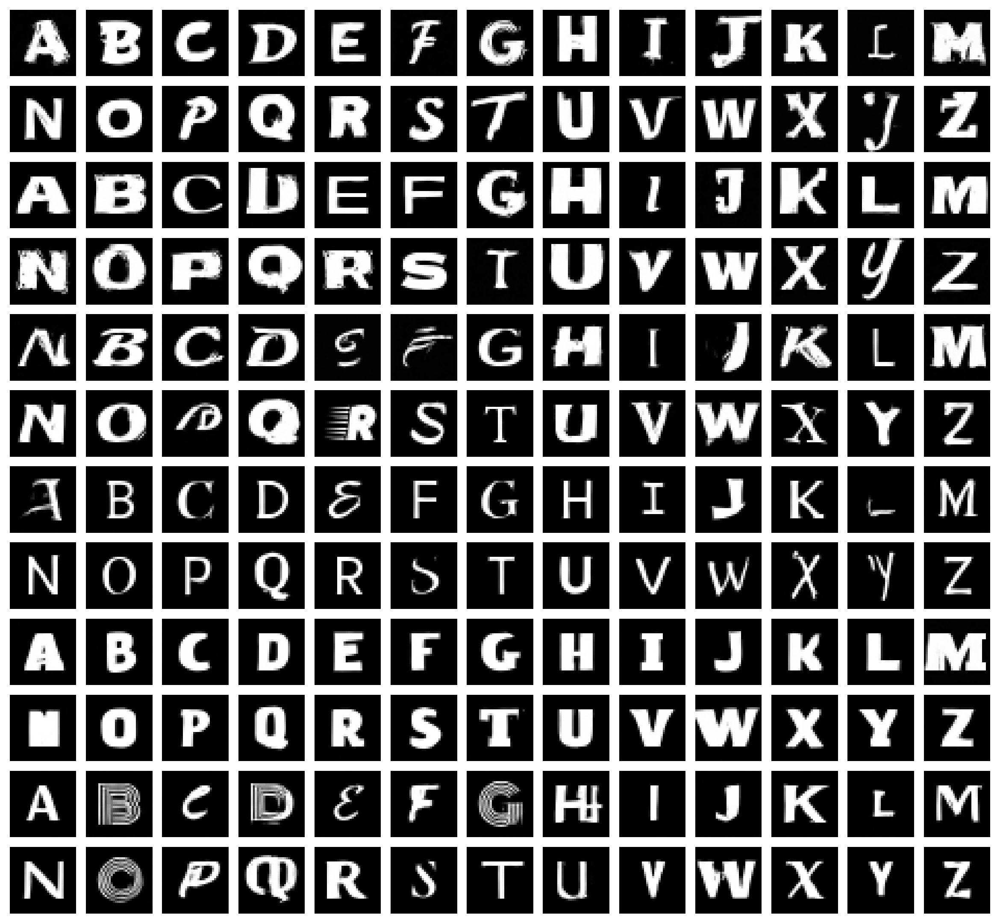
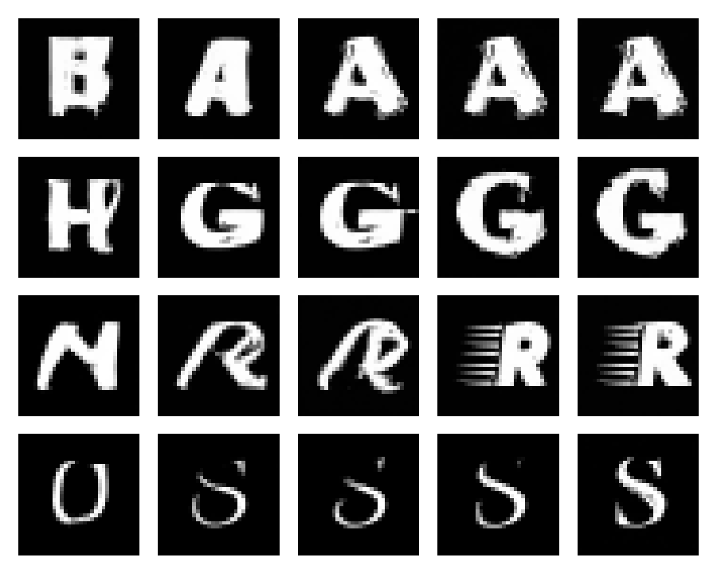
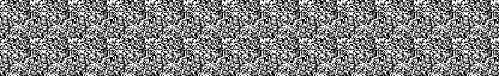
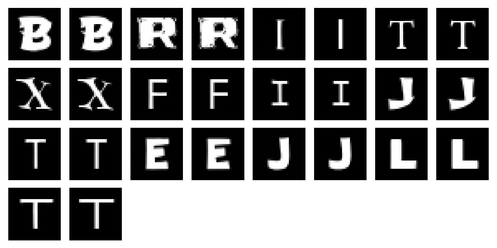

# Invent-a-Font

A diffusion model, written from scratch in PyTorch, that invents typefaces. Give it a letter and some noise and it draws A–Z in a new style.



*Each pair of rows is one random noise, so one invented typeface. The model draws all 26 letters from it. Seeds 1–6, not cherry-picked.*

## What this is

- 32×32 grayscale uppercase glyphs, trained on 100 fonts (2,600 glyphs).
- Everything diffusion-specific is written by hand: cosine noise schedule, forward process, U-Net with time and letter embeddings, DDPM and DDIM samplers, classifier-free guidance.
- PyTorch is used for tensors, autograd, optimizers and basic layers. No `diffusers`, no ready-made schedulers or U-Nets.

## How it works

1. **Noise schedule.** Cosine schedule, T = 1000 steps.
2. **Model.** A small U-Net that predicts the noise in an image. It gets the step and the requested letter as embeddings.
3. **Training.** Predict the added noise (MSE). 10% of the time the letter card is replaced with a blank card, so the model also learns to draw without a request.
4. **Sampling.** DDIM with 100 steps (DDPM with 1000 steps is also implemented). Classifier-free guidance mixes the blank-card and letter-card predictions: `eps = eps_blank + w * (eps_letter - eps_blank)`.
5. **Style from noise.** DDIM is deterministic, so one starting noise gives one style. Asking for A, B, C… from the same noise gives a whole alphabet.

### Guidance strip



*Rows: A, G, R, S. Columns: guidance w = 0, 1, 2, 3, 5. Each row keeps the same noise and the same requested letter, so only w changes. At w = 0 the model ignores the request and the noise alone sets the style.*

### Denoising



*All 26 letters start from the same noise and separate into A–Z.*

## Results

Evaluated on 520 samples (20 per letter), DDIM-100, with a separate judge network: a small classifier trained on 80 fonts and checked on 20 unseen fonts.

| guidance w | letter accuracy | variety | near-copies |
|---|---|---|---|
| 0 (no request) | 0.042 | n/a | 0.002 |
| 1 | 0.744 | 0.684 | 0.021 |
| 2 | 0.956 | 0.643 | 0.052 |
| **3** | **0.975** | 0.632 | 0.073 |
| 5 | 0.975 | 0.634 | 0.085 |
| *real, unseen fonts* | *0.837* | *0.685* | *0.015* |
| *pure noise* | *0.035* | *1.016* | *0.000* |

- **Letter accuracy:** the judge reads the requested letter. Random guessing is 0.038.
- **Variety:** average distance between images of the same letter (higher means more varied). At w = 0 the letters are not the requested ones, so this number is not meaningful.
- **Near-copies:** share of samples closer than 0.1 to a training glyph (RMS pixel distance).
- Guidance w = 3 is the sweet spot. Accuracy stops improving past it, while copies keep rising.
- Copy check on the alphabet sheet: 13 of 156 glyphs (8%) are within 0.1 of a training glyph. Most are simple letters (I, T, F, J, L, E) that look alike in many fonts. B, R and X are close copies of a training font. Mean distance to the nearest training glyph is 0.32.



*Copy check pairs: each generated glyph, followed by its nearest training glyph.*

## Limits (honest notes)

- Only 100 fonts, so the model partly memorises: some outputs are close to a training glyph (see the near-copy column and the copy check).
- The judge scoring higher on generated letters than on real unseen fonts (0.975 vs 0.837) means the generated letters are typical and easy to read. It does not mean they are better than real fonts.
- The judge is trained on 80 of the 100 fonts, while the generator is trained on all 100.
- Higher guidance gives more readable letters but a bit less variety and more copies.
- 32×32 pixels and uppercase only. No lowercase, digits or vector output.
- The same noise only tends to give the same style. Some letters in a typeface drift to another look.

## Run it

```
pip install -r requirements.txt
python train.py             # conditional model: checkpoints/cond_last.pt and cond_best.pt
python train_judge.py       # judge network: checkpoints/judge.pt
python sample.py            # A–Z grid from one noise
python evaluate.py sweep    # guidance sweep table
python showcase.py          # sheet, strip, GIF and copy check
```

Settings live in the `cfg` dictionary at the bottom of each script. Fonts are not in the repo (see below), so put your own `.ttf` files in `data/raw/fonts/`.

## Fonts and licences

The fonts used for training are not included in this repository.

TODO: list the fonts and their licences here (including the Roboto font under the Apache 2.0 licence).